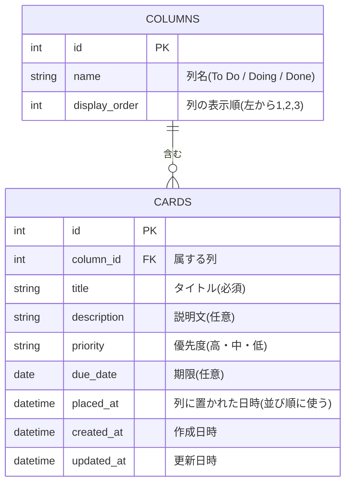

# データ設計書:Trello風タスク管理アプリ

作成日:2026-10-20 / 作成者:futa / 版数:0.1 / 状態:たたき台
関連文書:[要件定義書](requirements.md)、[画面設計書](screen-design.md)

## 1. データ設計の方針
- 実際のDBを使って運用する(バックエンドを作る想定)。利用者は1人で、マルチユーザー対応はしない。
- この文書は**論理設計**(何を持つか)までを扱う。データ型や制約などの**物理設計**は、技術選定でDBを決めた後に行う。
- ボードとユーザーはエンティティにしない(ボードは1つだけ、ログインなしのため)。

## 2. ER図

### 読み方
- `COLUMNS ||--o{ CARDS`:1つの列(COLUMNS)に、カード(CARDS)が0枚以上ある。カードは必ず1つの列に属する(1対多)。
- PK は主キー(1件を特定する項目)、FK は外部キー(他のテーブルの1件を指す項目)。

## 3. エンティティ一覧
| エンティティ | 意味 | 件数の目安 |
|---|---|---|
| COLUMNS(列) | To Do / Doing / Done の縦の列 | 3件(固定) |
| CARDS(カード) | 1つのタスク | 全体で200枚まで(NF-01) |

## 4. 項目定義
### 4.1 COLUMNS(列)
| 項目名 | 論理名 | 型(論理) | 必須 | 備考 |
|---|---|---|---|---|
| id | 列ID | 整数 | 必須 | 主キー |
| name | 列名 | 文字 | 必須 | To Do / Doing / Done |
| display_order | 表示順 | 整数 | 必須 | 左から 1、2、3 |

初期データ(最初から入れておく3件):
| id | name | display_order |
|---|---|---|
| 1 | To Do | 1 |
| 2 | Doing | 2 |
| 3 | Done | 3 |

### 4.2 CARDS(カード)
| 項目名 | 論理名 | 型(論理) | 必須 | 上限 | 備考 |
|---|---|---|---|---|---|
| id | カードID | 整数 | 必須 | - | 主キー |
| column_id | 列ID | 整数 | 必須 | - | 外部キー(COLUMNS.id) |
| title | タイトル | 文字 | 必須 | 50文字 | 空は不可 |
| description | 説明文 | 文字 | 任意 | 500文字 | 改行可 |
| priority | 優先度 | 文字 | 必須 | - | 高・中・低のいずれか。追加時の初期値は「中」 |
| due_date | 期限 | 日付 | 任意 | - | 期限なしは空 |
| placed_at | 列に置かれた日時 | 日時 | 必須 | - | 作成時と、別の列へ移動した時に更新する。並び順に使う |
| created_at | 作成日時 | 日時 | 必須 | - | カードを作った日時 |
| updated_at | 更新日時 | 日時 | 必須 | - | 編集または移動した日時 |

## 5. 業務ルール(データの扱い)
### 5.1 表示順
- 列の中では、`placed_at` が新しい順(降順)に上から並べる。同じ日時の場合は `id` が大きい順にする。
- 列は `display_order` の順に左から並べる。
- 編集しても `placed_at` は変わらないので、編集したカードの位置は動かない。

### 5.2 操作ごとのデータの動き
| 操作 | ユースケース | 動き |
|---|---|---|
| カード追加 | UC-02 | `column_id` を To Do(1)にして新規作成。`placed_at`、`created_at`、`updated_at` に現在日時を入れる |
| カード編集 | UC-03 | title、description、priority、due_date を更新し、`updated_at` を現在日時にする。`placed_at` と `column_id` は変えない |
| カード移動 | UC-04 | `column_id` を移動先の列にし、`placed_at` と `updated_at` を現在日時にする(移動先の列の一番上に入る) |
| カード削除 | UC-05 | カードを削除する。復元はしない |
| ボード表示 | UC-01 | 全カードを列ごとに、5.1 の順で取り出す |

### 5.3 期限切れの判定
- 期限(`due_date`)が今日より前(昨日以前)なら期限切れとする。期限が今日の場合と、期限が空の場合は期限切れにしない(F-08)。

## 6. 画面項目との対応
| 画面の項目 | データの項目 |
|---|---|
| 列見出しの列名 | COLUMNS.name |
| 列見出しのカード枚数 | その列のカード数(CARDS を column_id で数える) |
| カードのタイトル | CARDS.title |
| カードの優先度の色 | CARDS.priority |
| カードの期限 | CARDS.due_date |
| S-02 の説明文 | CARDS.description |

## 7. 物理設計への引き継ぎ(技術選定のあとに決める)
- 使うDB製品と、各項目の具体的なデータ型
- 制約:タイトルの NOT NULL、優先度を「高・中・低」に限る制約、外部キー制約
- 文字数上限の検査を、画面側とDB側のどちらで行うか
- 索引(インデックス):列ごとの並び(`column_id` と `placed_at`)に張るか
