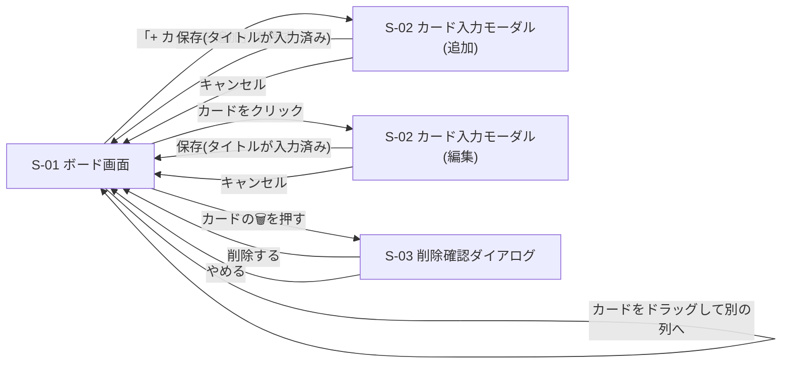

# 画面設計書:Trello風タスク管理アプリ

作成日:2026-10-20 / 作成者:futa / 版数:0.1 / 状態:たたき台
関連文書:[要件定義書](requirements.md)

## 1. 画面設計の方針
- アプリは1ページだけで構成する(NF-08)。ページの上に重なる入力ウィンドウや確認ダイアログも、別の「画面」として数える。
- 画面の幅は1280px以上のパソコン画面を前提とする(NF-06)。
- 説明文の確認、追加、編集、削除の操作は、次の「3. 決定事項」に従う。

## 2. 画面一覧
| ID | 画面 | 役割 | 関係するユースケース |
|---|---|---|---|
| S-01 | ボード画面 | 3列とカードを表示する。すべての操作の起点 | UC-01、UC-04 |
| S-02 | カード入力モーダル | 追加と編集で共用する入力ウィンドウ。説明文の確認も兼ねる | UC-02、UC-03 |
| S-03 | 削除確認ダイアログ | 削除してよいかを確認する | UC-05 |

## 3. 決定事項
- 説明文はカード上に表示せず、カードをクリックして開く S-02 で確認する(確認と編集を兼ねる)(2026-10-20 決定)
- カードの追加は、To Do 列の上の「+ カードを追加」ボタンから、S-02 を開いて行う(2026-10-20 決定)
- カードの編集は「カードをクリック」、削除は「カードの🗑ボタン」で行う(2026-10-20 決定)

## 4. 画面レイアウト(ワイヤーフレーム)
### 4.1 S-01 ボード画面
```
┌─────────────────────────────────────────────────────────────┐
│  タスク管理ボード                                            │
├───────────────────┬───────────────────┬─────────────────────┤
│ To Do (3)         │ Doing (1)         │ Done (2)            │
│ [+ カードを追加]   │                   │                     │
│ ┌───────────────┐ │ ┌───────────────┐ │ ┌─────────────────┐ │
│ │■高 資料を作る  │ │ │■中 レビュー    │ │ │■低 掃除          │ │
│ │ 期限 10/20 [🗑]│ │ │ 期限 10/25 [🗑]│ │ │ 期限 なし   [🗑] │ │
│ └───────────────┘ │ └───────────────┘ │ └─────────────────┘ │
│ ┌───────────────┐ │                   │                     │
│ │■中 …           │ │                   │                     │
│ └───────────────┘ │                   │                     │
└───────────────────┴───────────────────┴─────────────────────┘
  ■ = 優先度の色(高=赤、中=黄、低=緑)
  期限が昨日以前のカードは、期限の文字を赤にする
```

### 4.2 S-02 カード入力モーダル(追加・編集 共用)
```
┌──────────────────────────────┐
│ カードを追加   (編集時は「カードを編集」) │
│ タイトル *    [______________]  │
│ 説明文        [______________]  │
│               [______________]  │
│ 優先度 *      [中 ▼]            │
│ 期限          [____年__月__日]   │
│               [キャンセル] [保存] │
└──────────────────────────────┘
```

### 4.3 S-03 削除確認ダイアログ
```
┌──────────────────────┐
│ 本当に削除しますか?    │
│   [やめる] [削除する]  │
└──────────────────────┘
```

## 5. 画面遷移図


## 6. 画面項目定義
### 6.1 S-01 ボード画面
| 項目 | 内容 | 備考 |
|---|---|---|
| 列見出し | 列名(To Do / Doing / Done)とカード枚数 | F-01 |
| カード追加ボタン | 「+ カードを追加」。To Do 列の上だけに置く | 押すと S-02(追加)を開く。F-02 |
| カード | 優先度の色、タイトル、期限、🗑ボタン | F-03。説明文は表示しない |
| 優先度の色 | 高=赤、中=黄、低=緑 | F-07 |
| 期限の表示 | M/D の形式。期限なしは「なし」 | 内部では年を含めて保持する |
| 期限切れの表示 | 期限の翌日以降は、期限の文字を赤にする。当日は赤にしない | F-08 |
| 🗑ボタン | 押すと S-03 を開く | カードをクリックしても S-02 は開かない |
| カードのクリック | S-02(編集)を開く | F-09、説明文の確認 |
| ドラッグ | 別の列へドロップすると移動する | F-04。移動先の列の一番上に入る。同じ列内の並び替えはしない |

### 6.2 S-02 カード入力モーダル
| 項目 | 型 | 必須 | 上限 | 備考 |
|---|---|---|---|---|
| タイトル | 1行入力 | 必須 | 50文字 | 空のままでは保存できない |
| 説明文 | 複数行入力 | 任意 | 500文字 | 編集時はここで全文を確認できる |
| 優先度 | 選択(高・中・低) | 必須 | - | 追加時の初期値は「中」 |
| 期限 | 日付選択 | 任意 | - | 消して「期限なし」に戻せる |
| キャンセルボタン | ボタン | - | - | 入力内容を捨てて S-01 に戻る |
| 保存ボタン | ボタン | - | - | 入力内容を確定して S-01 に戻る |

- 追加時は、各項目が初期値の状態で開く。編集時は、カードの現在の内容が入った状態で開く。
- タイトルが空のまま保存を押した場合は、保存せず、M-01 を表示して S-02 を開いたままにする。
- 文字数の上限は、データ設計書(data-design.md)で正式に決定した値。

### 6.3 S-03 削除確認ダイアログ
| 項目 | 内容 |
|---|---|
| メッセージ | M-02 |
| 「削除する」ボタン | カードを削除して S-01 に戻る |
| 「やめる」ボタン | 何も変えずに S-01 に戻る |

## 7. メッセージ定義
| ID | 表示する場面 | 文言 | 備考 |
|---|---|---|---|
| M-01 | タイトルが空のまま保存 | タイトルを入力してください | |
| M-02 | 削除の確認 | 本当に削除しますか? | |
| M-03 | 保存に失敗 | 保存できませんでした。もう一度お試しください | 暫定。保存の仕組みが決まったら見直す |
| M-04 | データの読み込みに失敗 | データを読み込めませんでした | 暫定。保存の仕組みが決まったら見直す |

## 8. 操作と機能・ユースケースの対応
| 利用者の操作 | 画面 | ユースケース | 機能要件 |
|---|---|---|---|
| アプリを開く | S-01 | UC-01 | F-01、F-03、F-07、F-08 |
| 「+ カードを追加」を押し、入力して保存 | S-01 → S-02 | UC-02 | F-02 |
| カードをクリックし、修正して保存 | S-01 → S-02 | UC-03 | F-09 |
| カードをドラッグして別の列へ | S-01 | UC-04 | F-04 |
| 🗑を押し、削除を承諾 | S-01 → S-03 | UC-05 | F-05 |
| 再読み込みしても内容が残る | S-01 | UC-01(事前条件) | F-06 |
